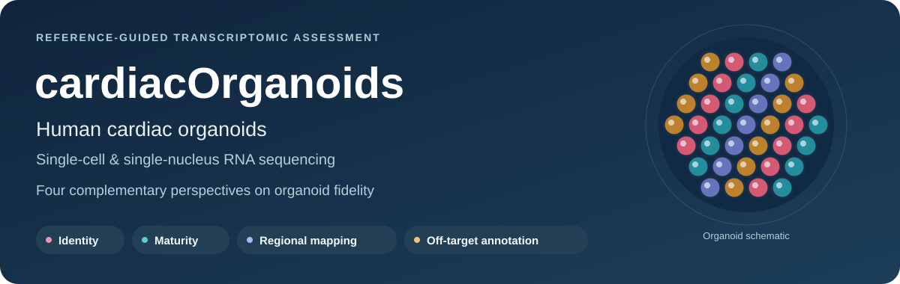

<p align="center">
  
</p>

# cardiacOrganoids

R code for assessing human cardiac organoids against human heart reference transcriptomes.

We compare single-cell and single-nucleus RNA-seq datasets across four aspects of organoid fidelity: cell identity, transcriptional maturity, atrial/ventricular characteristics and the identity of cells left unassigned by heart references.

[](https://www.r-project.org/)
[](LICENSE)

[Overview](#overview) · [Workflow](#workflow) · [Code guide](#code-guide) · [Getting started](#getting-started) · [Run guide](docs/running-analyses.md)

## Overview

| Analysis | Question | Approach |
| :--- | :--- | :--- |
| Cell identity | How closely do organoid cell-type gene programs match the adult heart reference? | Cepo gene specificity scores and Pearson correlations across repeated organoid subsamples. |
| Maturity | How do organoid and adult heart cells compare on transcriptional measures of differentiation and maturity? | CytoTRACE2 and gene-expression entropy, calculated separately for single cells and nuclei. |
| Regional mapping | Do organoid cardiomyocytes have atrial or ventricular transcriptional characteristics? | Seurat scoring of reference-derived gene modules, followed by atrial, ventricular or unresolved assignments. |
| Off-target annotation | Which cell identities might explain cells left unassigned by heart references? | Fetal-heart consensus classification, then Cao fetal multi-organ Azimuth mapping for cells that remain unassigned. |

The processing scripts split the organoid datasets into 22 single-cell and 4 single-nucleus subsets by study, time point, chamber or condition. These counts refer to analysis subsets, not biological replicates. The off-target pipeline uses the 22 single-cell subsets.

## Workflow


*Conceptual workflow with no measured results. Single-cell and single-nucleus data are analysed separately where supported.*

We assign initial cell types using scClassify, Seurat label transfer and SingleR. A consensus requires at least two matching predictions. Other cells are labelled `unassigned` and passed to the off-target analysis, which first uses the fetal heart reference, then maps cells still unassigned to a fetal multi-organ reference. These mappings suggest possible identities that need biological validation.

## Code guide

| Directory | Contents | Entry points |
| :--- | :--- | :--- |
| [`scripts/dataset_processing/`](scripts/dataset_processing) | Prepare the adult heart reference and organoid datasets, assign consensus cell types, and split the organoids into analysis subsets. | `01_adult_data_processing.R` → `02_organoid_data_processing.R` → `03_cell_type_annotation.R` → `04_save_objects.R` |
| [`scripts/identity/`](scripts/identity) | Calculate Cepo scores, average reference scores, subsample organoids and compare cell-type gene programs. | Load `01_cepo_functions.R`, then work through `02_cepo_analysis.R` for one modality at a time. |
| [`scripts/maturity/`](scripts/maturity) | Calculate CytoTRACE2 and expression-entropy scores. | `01_cytotrace.R` for CytoTRACE2. Load `02_entropy_functions.R` before `03_entropy.R` for entropy. |
| [`scripts/RM/`](scripts/RM) | Score cardiomyocytes with atrial and ventricular gene modules. | Run scripts `01` to `05`, repeating the scoring steps for each reference and modality as shown in the [run guide](docs/running-analyses.md#regional-mapping). |
| [`scripts/OTA/`](scripts/OTA) | Check inputs, reclassify unassigned cells with fetal-heart and multi-organ references, and plot the results. | Run scripts `01` to `03`, then use `04_extra-cardiac_visualization.Rmd`. |

## Getting started

### 1. Get the code

```bash
git clone https://github.com/PYangLab/cardiacOrganoids.git
cd cardiacOrganoids
```

### 2. Prepare an R environment

Install the packages needed for your analysis using their maintainers' instructions. Off-target classification needs Seurat ≥ 5.0, and the multi-organ mapping step also needs Azimuth ≥ 0.5.1.

| Module | Main packages used |
| :--- | :--- |
| Dataset processing and annotation | Seurat, Matrix, SingleCellExperiment, zellkonverter, rhdf5, scReClassify, scClassify, SingleR, BiocParallel, purrr, readr, dplyr |
| Cell identity | Cepo, SeuratObject, dplyr, tibble, tidyr, matrixStats, purrr |
| Maturity | CytoTRACE2, Seurat, SeuratObject |
| Regional mapping | Seurat, SeuratObject, Matrix, ggplot2, readxl, future |
| Off-target annotation and visualisation | Seurat, Matrix, scClassify, SingleR, BiocParallel, Azimuth, ggrepel, ggplot2, rmarkdown, knitr |

The repository has no package lockfile or complete tested environment specification. Save `sessionInfo()` with your results so you can track the R and package versions used.

### 3. Prepare the data and paths

You'll need to obtain the input datasets, processed Seurat objects, module gene-set workbook and Azimuth reference files separately. Check the filenames, RNA layers and metadata required by the analysis you want to run.

The processing, identity and maturity scripts use local paths such as `~/Cardiac_organoids/` and `~filepath/`. Change these to your own locations.

Run the regional mapping and off-target scripts from their own directories so they can find their helper files. Both accept input and output paths on the command line. They expect different input filenames from those used in the processing scripts, as detailed in the [input checklist and execution examples](docs/running-analyses.md).

### 4. Choose an analysis

If you're starting with raw data, work through [dataset processing](scripts/dataset_processing) interactively and prepare the inputs for the analyses you need. With prepared inputs, follow the [run guide](docs/running-analyses.md) for regional mapping or off-target annotation.

For identity or maturity analyses, load the helper functions first and select the single-cell or single-nucleus data. The entropy calculation also needs an external resource described in the run guide.

Check each script before running it as a batch job. Some steps use objects created earlier in the R session, and some saving statements are commented out.

## Questions and reuse

If a script fails or you have a question about reproducing an analysis, [open an issue](https://github.com/PYangLab/cardiacOrganoids/issues). Include the script name, input structure, error message and R session information.

For project questions, contact:

- Anna Fredericks: [afredericks@cmri.org.au](mailto:afredericks@cmri.org.au)
- Siqu Long: [slong@cmri.org.au](mailto:slong@cmri.org.au)
- Pengyi Yang: [pengyi.yang@sydney.edu.au](mailto:pengyi.yang@sydney.edu.au)

The code is licensed under the [GNU General Public License v3.0](LICENSE). External datasets and references have their own terms of use. Please cite their original publications and the methods you use.
