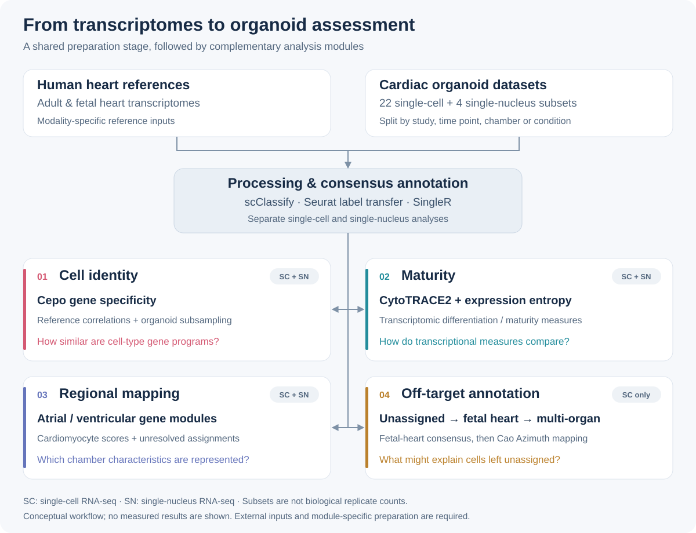

<p align="center">
  
</p>

# cardiacOrganoids

**Reference-guided, multidimensional assessment of human cardiac organoids.**

Analysis code for comparing human cardiac organoids with human heart reference transcriptomes using single-cell and single-nucleus RNA sequencing. The analyses examine cell-type identity, transcriptional maturity, atrial/ventricular characteristics, and cells that remain unassigned by heart references.

[](https://www.r-project.org/)
[](LICENSE)

[Overview](#overview) · [Workflow](#workflow) · [Code guide](#code-guide) · [Getting started](#getting-started) · [Run guide](docs/running-analyses.md)

## Overview

How closely do cardiac organoids resemble the human heart? This repository brings together complementary transcriptomic analyses to assess different aspects of that resemblance.

| Analysis | Question | Approach |
| :--- | :--- | :--- |
| **Cell identity** | How similar are organoid cell-type gene programs to the adult heart reference? | Cepo gene specificity scores and Pearson correlations, with repeated organoid subsampling. |
| **Maturity** | How do organoid cells compare with adult heart cells in transcriptional measures related to differentiation and maturity? | CytoTRACE2 and gene-expression entropy, analysed separately for single cells and nuclei. |
| **Regional mapping** | Do organoid cardiomyocytes show atrial or ventricular transcriptional characteristics? | Reference-derived gene modules, Seurat module scoring, and atrial/ventricular/unresolved assignments. |
| **Off-target annotation** | What might explain cells left unassigned by heart references? | Sequential fetal-heart consensus classification and Cao fetal multi-organ Azimuth mapping. |

The processing scripts organise the organoids into **22 single-cell subsets** and **4 single-nucleus subsets**, split by study, time point, chamber or condition. These are analysis subsets, rather than counts of biological replicates. The off-target pipeline currently operates on the 22 single-cell subsets.

## Workflow



*Conceptual workflow; the diagram shows analysis structure, not measured results. Single-cell and single-nucleus data are handled separately where supported.*

Initial organoid annotation uses **scClassify**, **Seurat label transfer** and **SingleR**. At least two matching predictions are required for a consensus label; other cells are labelled `unassigned`. For the off-target analysis, these cells are assessed against the fetal heart reference, and cells still unassigned are mapped to a fetal multi-organ reference. Such mappings are evidence for interpretation and require biological validation.

## Code guide

| Directory | Contents | Entry points |
| :--- | :--- | :--- |
| [`scripts/dataset_processing/`](scripts/dataset_processing) | Adult heart reference preparation, organoid processing, consensus annotation and subset construction. | `01_adult_data_processing.R` → `02_organoid_data_processing.R` → `03_cell_type_annotation.R` → `04_save_objects.R` |
| [`scripts/identity/`](scripts/identity) | Cepo helper functions, reference averaging, organoid subsampling and correlation analysis. | Load `01_cepo_functions.R`, then work through `02_cepo_analysis.R` for one modality at a time. |
| [`scripts/maturity/`](scripts/maturity) | CytoTRACE2 and expression-entropy calculations. | `01_cytotrace.R`; load `02_entropy_functions.R` before `03_entropy.R`. |
| [`scripts/RM/`](scripts/RM) | Regional mapping of cardiomyocytes using atrial/ventricular gene modules. | Run numbered scripts `01`–`05`; repeat reference scoring and organoid scoring as described in the [run guide](docs/running-analyses.md#regional-mapping). |
| [`scripts/OTA/`](scripts/OTA) | Input validation, fetal-heart reclassification, fetal multi-organ mapping and visualisation. | Run numbered scripts `01`–`03`, then use `04_extra-cardiac_visualization.Rmd`. |

## Getting started

### 1. Get the code

```bash
git clone https://github.com/PYangLab/cardiacOrganoids.git
cd cardiacOrganoids
```

### 2. Prepare an R environment

The scripts use the packages below. Install the dependencies for the modules you intend to run, following their maintainers' installation instructions. Off-target classification requires **Seurat ≥ 5.0**; its multi-organ mapping step additionally requires **Azimuth ≥ 0.5.1**.

| Module | Main packages used |
| :--- | :--- |
| Dataset processing and annotation | Seurat, Matrix, SingleCellExperiment, zellkonverter, rhdf5, scReClassify, scClassify, SingleR, BiocParallel, purrr, readr, dplyr |
| Cell identity | Cepo, SeuratObject, dplyr, tibble, tidyr, matrixStats, purrr |
| Maturity | CytoTRACE2, Seurat, SeuratObject |
| Regional mapping | Seurat, SeuratObject, Matrix, ggplot2, readxl, future |
| Off-target annotation and visualisation | Seurat, Matrix, scClassify, SingleR, BiocParallel, Azimuth, ggrepel, ggplot2, rmarkdown, knitr |

A package lockfile and a complete tested environment specification are not included in the current upload. Record `sessionInfo()` when running an analysis.

### 3. Prepare the data and paths

**This repository contains analysis code; the input datasets, processed Seurat objects, module gene-set workbook and Azimuth reference files are not included.**

Before running, obtain the inputs required by your chosen module and check its expected filenames, RNA layers and metadata. The original processing, identity and maturity scripts contain local paths such as `~/Cardiac_organoids/` and `~filepath/`; update these for your environment.

The regional mapping and off-target modules accept command-line paths, but must be launched from their respective script directories because they source local helper files. Their prepared input filenames also differ from the filenames in the processing scripts. See the [input checklist and execution examples](docs/running-analyses.md).

### 4. Choose an analysis

- **Starting from raw data:** work through [dataset processing](scripts/dataset_processing) interactively, then prepare inputs for the required assessment modules.
- **Using prepared inputs:** follow the [run guide](docs/running-analyses.md) for regional mapping or off-target annotation.
- **Running identity or maturity analyses:** load the helper functions first, select the appropriate modality, and check the external entropy resource before executing.

These are research analysis scripts with module-specific prerequisites. Some steps rely on objects created earlier in the R session, and some saving statements are commented out. Review each script before running it as a batch job.

## Questions and reuse

For code questions or reproducibility issues, [open an issue](https://github.com/PYangLab/cardiacOrganoids/issues) with the script name, input structure, error message and R session information.

The code is distributed under the [GNU General Public License v3.0](LICENSE). External datasets and reference resources retain their own terms; acknowledge their original publications and the methods used in your analysis.
